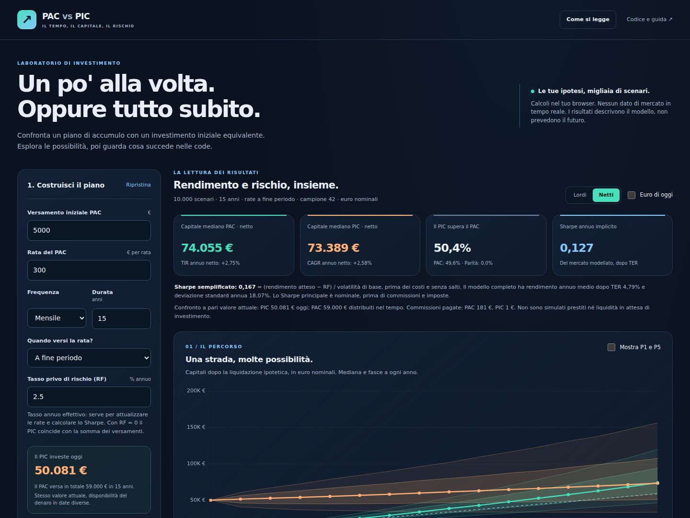

# PAC vs PIC: il tempo, il capitale, il rischio

**Conviene investire una rata alla volta o una somma subito?** Questo laboratorio ti aiuta a esplorare la domanda con le tue ipotesi, mostrando sia il capitale finale sia gli scenari sfavorevoli.

**[Apri il simulatore](https://d4br1c3.github.io/pac-montecarlo-simulator/)**

Non devi installare Python, creare account o caricare dati. La simulazione gira nel browser. Il progetto include anche la libreria dei grafici e non richiede servizi esterni durante l'uso.



## Parti da qui

1. **Costruisci il PAC.** Inserisci il versamento iniziale, la rata, la frequenza e la durata. Scegli se la rata arriva a inizio o a fine periodo.
2. **Imposta il mercato.** Scegli rendimento atteso, volatilità e tasso privo di rischio (RF). Puoi includere salti improvvisi di mercato e modificare costi, imposte e inflazione.
3. **Premi “Simula gli scenari”.** Leggi la mediana e le fasce del grafico, poi osserva VaR ed Expected Shortfall. Non fermarti al risultato medio.

Per orientarti trovi il pulsante **Come si legge** anche nell'app. I valori iniziali sono esempi didattici: non sono previsioni aggiornate sull'azionario globale.

## Che cosa stai confrontando

- **PAC:** un versamento iniziale e rate successive, finanziate nel tempo.
- **PIC:** una somma investita subito, pari al **valore attuale** dei flussi del PAC, scontati al RF.

Per esempio, con **5.000 € iniziali + 300 € al mese per 15 anni**, il PAC versa 59.000 € nominali. Con rate a fine mese e RF annuo effettivo del 2,5%, il PIC parte da circa **50.081 €**. Con RF = 0 parte da 59.000 €.

Questo equipara il valore finanziario iniziale dei flussi. **Non rende identica la disponibilità del denaro:** i risparmi futuri non sono denaro già disponibile. Il simulatore non include un prestito per anticiparli.

Se hai già tutta la somma e vuoi decidere se investirla gradualmente, servirebbe invece un confronto con una riserva di liquidità che si riduce nel tempo. Quella modalità non è inclusa. I risultati degli studi sull'ingresso graduale di una somma già disponibile non si trasferiscono automaticamente a questo confronto.

## Come leggere i risultati

| Voce | Significato pratico |
| --- | --- |
| Capitale mediano | La metà degli scenari termina sotto questo valore, la metà sopra. |
| Fascia P10-P90 | Contiene l'80% dei capitali simulati **a ciascuna data**. Non garantisce che un intero percorso resti nella fascia. |
| Fascia P25-P75 | Mostra il 50% centrale dei capitali. |
| Linee P1 e P5 | Evidenziano gli esiti bassi del ventaglio; puoi attivarle senza perdere le fasce precedenti. |
| Il PIC supera il PAC | Quota dei casi in cui il PIC termina con più capitale, sugli **stessi percorsi di mercato**. Le parità sono riportate a parte. |
| TIR netto PAC | Rendimento annuo che tiene conto delle date e degli importi di tutti i versamenti, commissioni incluse. |
| CAGR netto PIC | Crescita annua equivalente del capitale iniziale, dopo imposta finale e commissione. |
| Sharpe implicito | Premio atteso rispetto al RF per unità di rischio dell'asset modellato. Non è lo Sharpe personale del PAC. |

Le colonne **lordo** e **netto** includono già TER e commissioni; differiscono per l'imposta. La tabella mostra sempre entrambi, con TIR e CAGR **netti**. La differenza tra due percentili non è il percentile della differenza: per il confronto sui medesimi scenari c'è una sintesi separata sotto la tabella.

### VaR 95/99 ed Expected Shortfall: le code

Il VaR è riferito alla **perdita a scadenza sull'intera durata del piano**, non alla perdita in un giorno o in un anno.

- **VaR 95%:** soglia superata da circa il 5% delle perdite simulate.
- **VaR 99%:** soglia superata da circa l'1% delle perdite simulate.
- **ES 95% / ES 99%:** perdita media rispettivamente nel peggior 5% / 1%. L'Expected Shortfall aiuta a leggere la gravità degli esiti oltre il VaR.

**Esempio:** un VaR 99% di 20.000 € significa che circa l'1% degli scenari perde più di 20.000 € rispetto al riferimento scelto. Non significa che 20.000 € sia la perdita massima. Un VaR negativo indica un guadagno anche alla soglia considerata.

Puoi scegliere il riferimento:

| Riferimento | La domanda a cui risponde |
| --- | --- |
| Capitale versato | Quanto posso restare sotto i miei versamenti? In euro di oggi, ogni rata viene deflazionata alla propria data. |
| Alternativa al RF | Quanto posso restare sotto la crescita degli stessi flussi al RF, con la medesima imposta finale semplificata? |

Con 10.000 scenari, l'ES 99% dipende da circa **100 esiti**. Aumenta a 25.000 o 50.000 scenari e prova anche un nuovo campione: le stime delle code restano incerte e dipendono dal modello.

### Lo Sharpe e la volatilità dei salti

L'app distingue due numeri:

- **Sharpe semplificato:** `(rendimento atteso − RF) / volatilità di base`. Con 5%, 2,5% e 15% vale circa **0,167**. È una lettura approssimata degli input, prima dei costi e senza il rischio dei salti.
- **Sharpe annuo del modello:** usa la media e la deviazione standard del rendimento annuo semplice dell'asset, comprendendo salti e TER. Con le impostazioni iniziali vale circa **0,127**: rendimento medio dopo TER circa 4,79%, deviazione standard annua circa 18,07%.

Attivare i salti mantiene il rendimento atteso impostato, grazie alla compensazione del drift, ma aumenta la dispersione. Quindi la volatilità di base del 15% non è la deviazione standard annua complessiva. Se il rischio è zero, lo Sharpe è **N.D.**, non infinito né zero.

### Drawdown: cosa succede durante il piano

Il drawdown è il calo da un massimo precedente. Puoi osservare:

- **Mercato senza versamenti:** stesso asset per entrambe le strategie, dopo TER. Isola il rischio del mercato.
- **Saldo dei piani:** considera il denaro realmente nel piano e i nuovi versamenti. Le rate possono contribuire a recuperare un calo del saldo PAC; questo non riduce il rischio intrinseco dell'asset.

Mediana, P95 e P99 del massimo drawdown sono distinti dal VaR a scadenza. Il drawdown usa **24 osservazioni l'anno**: non vede i minimi intraperiodali e può sottostimare il massimo calo continuo.

## Costi, imposte, inflazione

- La commissione viene prelevata da ogni **versamento positivo**. Se non c'è un ordine non c'è una commissione. Un ordine deve superare il suo costo.
- Il TER è un prelievo proporzionale continuo: un tasso `c` applica il fattore `exp(−c × anni)`.
- L'imposta, inizialmente al 26% e modificabile, si applica una sola volta al guadagno nominale positivo sul totale versato. Non sono previsti rimborsi per perdite. È un modello fiscale semplificato, non una ricostruzione integrale della fiscalità italiana.
- Non sono inclusi bollo, commissioni di vendita, spread, dividendi distribuiti, recupero delle minusvalenze o regole specifiche dei singoli strumenti.
- **Euro di oggi** converte i capitali al potere d'acquisto iniziale. Ogni versamento è deflazionato alla propria data; i rendimenti netti diventano reali tramite la relazione di Fisher. L'imposta continua a essere calcolata sui guadagni **nominali**.

## Ripetere, confrontare, esportare

Il numero chiamato **seed** identifica il campione casuale. Stesso seed e stesse ipotesi producono gli stessi risultati; il pulsante **Nuovo** ne prepara un altro. Se modifichi le ipotesi, l'app segnala che i risultati devono essere ricalcolati.

Passare da lordo a netto, agli euro di oggi o a un diverso riferimento del rischio riutilizza i medesimi scenari. **Copia tabella** trasferisce i percentili in formato tabulato. **Scarica CSV** include anche ipotesi, seed, VaR/ES, Sharpe e drawdown. Il CSV usa `;` come separatore e la virgola decimale, per agevolare l'apertura in Excel italiano.

## Usarlo dal tuo computer

1. Su GitHub scegli **Code → Download ZIP**.
2. Estrai l'intera cartella.
3. Apri **index.html** con un browser moderno.

Mantieni insieme i file e la cartella `vendor`: **il solo index.html non basta**. Non serve una connessione durante il calcolo. Se apri direttamente il file, il browser può bloccare il worker e il calcolo avviene nella pagina; con campioni grandi la pagina può risultare occupata fino alla conclusione.

Per chi sviluppa, un server statico locale consente il worker e un'interfaccia reattiva anche durante il calcolo. Con Python già installato, per esempio, esegui `python3 -m http.server 8000` dalla cartella del progetto e apri `http://localhost:8000`. Python non è necessario per l'uso ordinario.

## Pubblicazione e aggiornamenti

GitHub Pages può pubblicare il progetto dalla radice (`/`) del ramo `main`: **Settings → Pages → Deploy from a branch**. Non c'è una fase di compilazione.

Una **pull request** è una proposta di aggiornamento separata dal sito pubblicato. Apri **Files changed** per vedere il confronto e **Conversation** per la spiegazione e le verifiche. Quando la integri nel ramo pubblicato, GitHub Pages aggiorna il sito. Gli aggiornamenti richiedono tutti i file modificati, non solo l'HTML.

## Per approfondire o contribuire

- [Metodologia e formule](docs/METODOLOGIA.md): convenzioni sui tassi, modello di Merton, quantili, rischio e limiti.
- [Revisione del modello](docs/REVISIONE.md): problemi rilevati nella prima versione e correzioni.
- [Verifiche del browser](tests/README.md): controlli dell'interfaccia e dei download.

La logica finanziaria è in `engine.js`, separata dall'interfaccia (`app.js`, `styles.css`, `index.html`). `simulation-worker.js` esegue il calcolo in un worker. Chart.js 4.4.1 è incluso in `vendor` con la sua licenza MIT; il progetto non carica font, framework CSS o librerie da CDN.

Chi modifica i calcoli può eseguire i test senza installare pacchetti, con **Node.js 22 o successivo**:

```sh
node --test tests/engine.test.cjs
```

GitHub esegue automaticamente i controlli del motore sulle pull request e sugli aggiornamenti di `main`, tramite il workflow incluso.

I test verificano formule note di attualizzazione e capitalizzazione, date dei versamenti, TIR, fiscalità, inflazione, code e conservazione delle frequenze. Le verifiche Monte Carlo confrontano anche media, varianza e quantili con risultati analitici.

## Fonti

- William F. Sharpe, [The Sharpe Ratio](https://web.stanford.edu/~wfsharpe/art/sr/sr.htm), 1994: definizione ex ante e differenza rispetto al semplice rapporto rendimento/rischio.
- Basel Committee, [Market risk terminology, §§10.17-10.18](https://www.bis.org/committees/bcbs/basel-framework/standard/mar/10/inforce/2022-01-01/published/2019-12-15): VaR ed Expected Shortfall. Il simulatore non implementa il modello regolamentare bancario.
- MathWorks, [Merton jump diffusion model](https://www.mathworks.com/help/finance/merton.html): processo composto di Poisson e moltiplicatori lognormali.
- Megan Finlay e Josef Zorn, Vanguard, [Cost averaging: Invest now or temporarily hold your cash?](https://corporate.vanguard.com/content/dam/corp/research/pdf/cost_averaging_invest_now_or_temporarily_hold_your_cash.pdf), 2023: confronto su una somma già disponibile, diverso dal PAC finanziato nel tempo.

Questo è uno strumento didattico. Non usa dati storici per calibrare le ipotesi, non replica un indice e non fornisce una raccomandazione di investimento.
